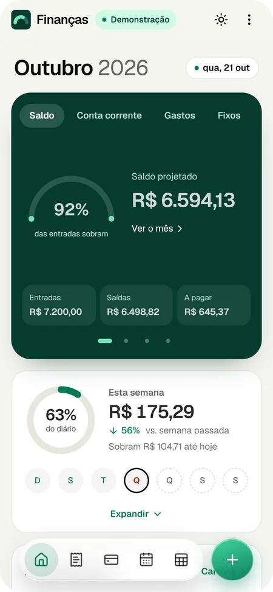
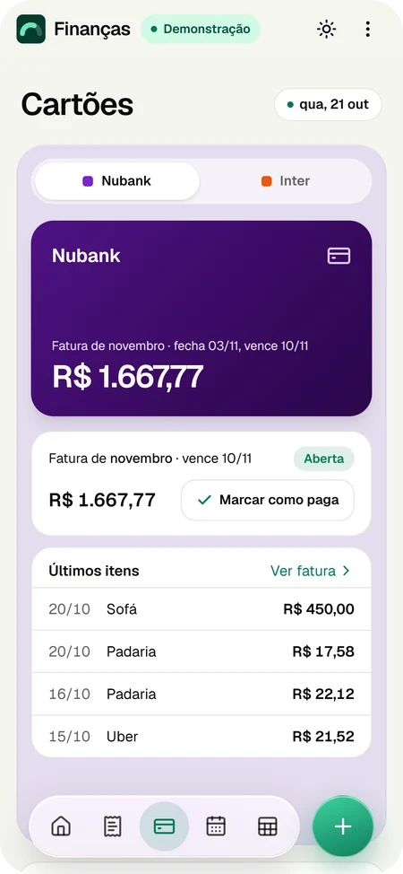
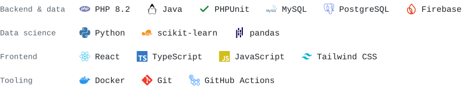

<a href="https://github.com/lucasschn1">English</a> · <b>Português</b>

# Lucas Schneider C.

**Desenvolvedor Full Stack**

Construo APIs testadas e os apps que as usam · PHP · TypeScript · React

[Sobre mim](#sobre-mim) · [Projetos](#projetos) · [Tecnologias](#tecnologias) · [Contato](#contato)

---

## Contribuições

 

## Sobre mim

Construo e testo serviços de backend — APIs REST, autenticação, pagamentos e
agendamento — com foco em design SOLID e cobertura de testes de verdade. No dia
a dia isso significa PHP 8.2 numa camada de Services com PHPUnit, modelagem de
dados relacional e integrações com Mercado Pago, Brevo e Notion, entregues com
Docker e GitHub Actions.

 

## Projetos

<table>
<tr>
<td>

### Finanças — App de finanças pessoais (PWA)

<code>projeto pessoal · da ideia à produção</code>

Um projeto pessoal que criei para substituir a planilha que eu usava no meu
próprio orçamento. Hoje é um app web em produção, que pode ser instalado no
celular e funciona offline. Fiz de ponta a ponta: requisitos, arquitetura,
interface, testes automatizados, CI/CD e documentação.

&nbsp;dados fictícios, sem login — melhor no celular

 
Início · Cartões · Conta corrente · Guardar — toque numa tela para abrir a demo

- **Produto** — lançar um gasto em segundos, faturas de cartão e parcelamentos, previsão do caixa para 12 meses e um simulador *"Posso gastar?"* que responde perguntas em linguagem natural
- **Arquitetura** — código TypeScript em camadas com fronteiras verificadas no CI, regras de negócio em funções puras e testáveis, valores em centavos inteiros para evitar erros de arredondamento
- **Segurança e custo** — sem servidor próprio, no plano gratuito do Firebase, com controle de acesso nas regras de segurança do Firestore cobertas por testes automatizados
- **Prática de engenharia** — testes de unidade, de interface e das regras de segurança com Vitest; deploy de preview para cada pull request e deploy automático em produção; mais de 80 registros de decisões de arquitetura

</td>
</tr>
</table>

<table>
<tr>
<td width="50%" valign="top">

#### ClinicaAme

<code>sistema de gestão de clínica</code>

Backend de gestão de clínica: autenticação, módulo financeiro e agendamento de
consultas sobre um modelo de dados bastante relacional. Construído numa camada
de Services com princípios SOLID e uma suíte PHPUnit passando.

</td>
<td width="50%" valign="top">

#### Previsão de ruído aerodinâmico (NASA)

<code>machine learning · regressão</code>

Random Forest dentro de um `Pipeline` do scikit-learn (sem vazamento entre
treino e teste), ajustado com `GridSearchCV` e validação cruzada sobre o
dataset de aerofólios da NASA — **MAE 1,33 dB, RMSE 1,84 dB**.

</td>
</tr>
<tr>
<td width="50%" valign="top">

#### Biblioteca Virtual Inteligente

<code>estruturas de dados · algoritmos</code>

Projeto de estudo de estruturas de dados: árvore binária de busca com percursos
DFS/BFS, pilha para o histórico, fila para as reservas e um grafo ponderado com
Dijkstra gerando recomendações de livros.

</td>
<td width="50%" valign="top">

#### Perfil do GitHub automatizado

<code>esta página · automação</code>

Uma GitHub Action agendada roda Python todo dia para gerar, como SVG, o retrato
em ASCII, o card no estilo neofetch, o card de stack e o mapa de calor de
contribuições — cada um se adapta sozinho aos temas claro e escuro do GitHub.

</td>
</tr>
</table>

 

## Tecnologias

<picture>
  <source media="(prefers-color-scheme: dark)" srcset="./assets/tech-card-dark.svg" />
  
</picture>

 

## Contato

Aberto a vagas de Backend e Full Stack — e-mail é o jeito mais rápido de falar comigo.  
Moro em São José dos Pinhais, Paraná.

---

Obrigado pela visita.

